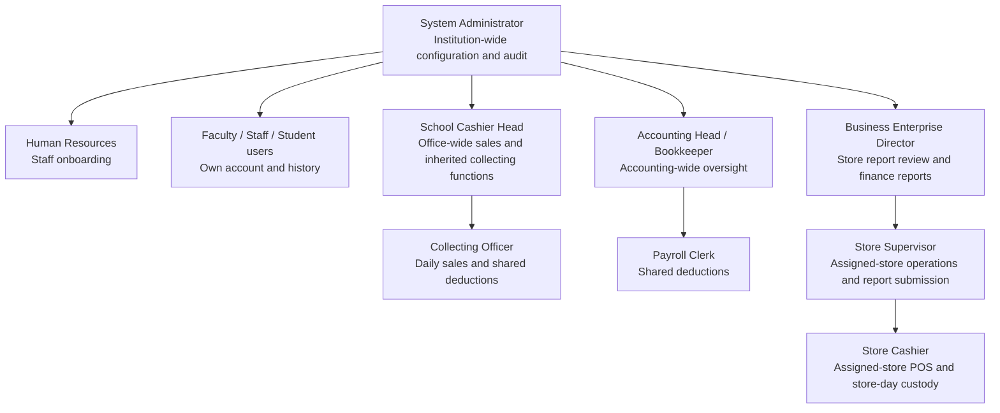
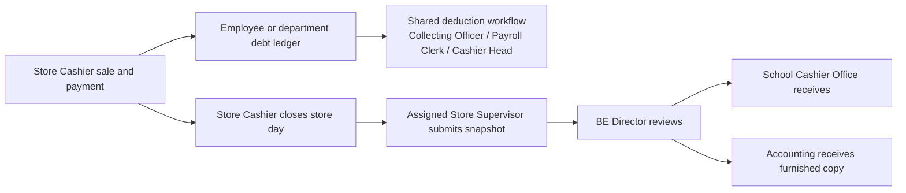

# IBEMS System Hierarchy

This is the current source reference for the external client document at `docs/client/IBEMS-System-Hierarchy.docx`. The client document must be regenerated and visually reviewed before it is treated as current. This is not a portal page.

The arrows describe the business hierarchy, not automatic permission inheritance. The only confirmed inheritance is Cashier Head access to the Collecting Officer's functions. The School Cashier Office is separate from the Store Cashier and Store Supervisor. A user's active role, not their position in this diagram, determines route access; store assignments further constrain store routes. System Administrator actions that affect financial records require documented, audited authority rather than implicit approval.

## Connected transaction and report flow

Partial deductions remain supported. Both the Collecting Officer and Payroll Clerk can confirm an actual deduction through the same service; preparation alone does not reduce debt. For exact route permissions and role scope, use `docs/ROLE_PERMISSION_MATRIX.md`.
